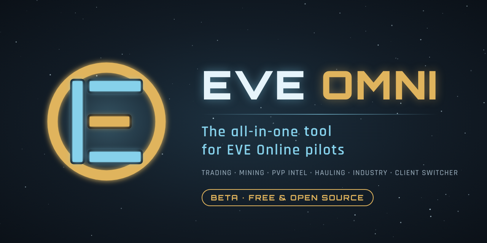
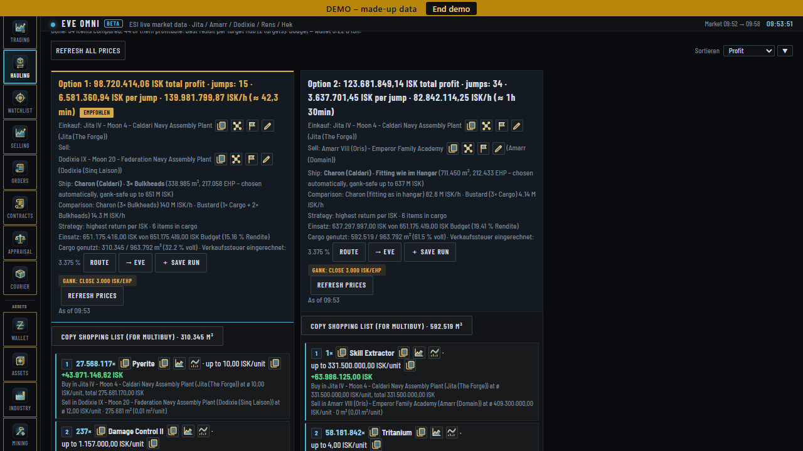
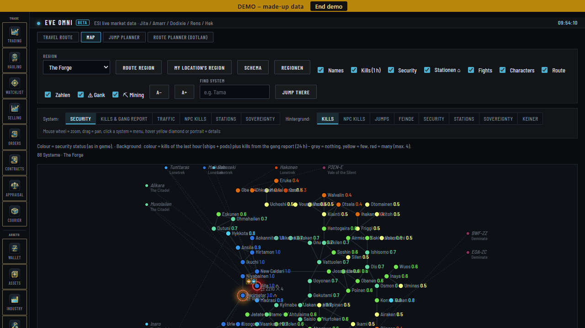
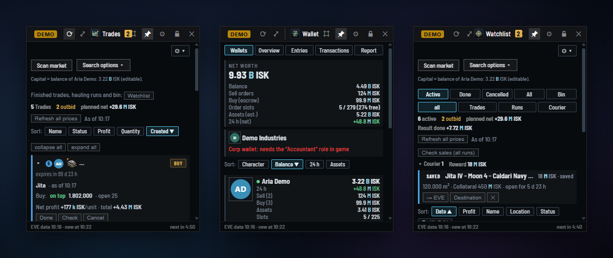

<p align="center">
  
</p>

<p align="center">
  <b>Free all-in-one desktop companion for EVE Online</b><br>
  Trading, hauling, mining, PvP intel, navigation & wormholes, industry, PI and skills<br>
  Multi-client preview · in-game overlay · Stream Deck
</p>

<p align="center">
  <a href="https://github.com/Nareya79/eve-omni/releases/latest"></a>
  <a href="https://github.com/Nareya79/eve-omni/releases"></a>
  <a href="https://discord.gg/Tyxt6J8yPR"></a>
  <a href="LICENSE"></a>
</p>

<p align="center">
  <a href="https://omni.nareya79.com">Website</a> ·
  <a href="https://github.com/Nareya79/eve-omni/releases/latest"><b>⬇ Download</b></a> ·
  <a href="https://discord.gg/Tyxt6J8yPR">Discord</a> ·
  <a href="https://www.youtube.com/@EVEOmni">YouTube</a> ·
  <a href="#installation">Installation</a> ·
  <a href="#faq">FAQ</a> ·
  <a href="README.de.md">Deutsch</a>
</p>

> **Status: public beta.** EVE Omni is free and under active development. New versions come out often, and the app tells you when one is available. Found a bug or have an idea? Tell us on [Discord](https://discord.gg/Tyxt6J8yPR) or open an [issue](../../issues).

---

## Highlights

### 🖥️ Multi-client preview – all your clients, one key
- **Live previews** of every EVE window in small always-on-top tiles – size, frame rate and position are up to you.
- **Tab through your clients** (or any key you choose), Shift+Tab goes back – in your order, character select skipped.
- **Click a preview** to bring that client to the front; a gold frame marks the active one.
- **Fair play:** one key press switches one window. EVE Omni never sends keys or clicks to the game and never repeats input across clients.

### 🪟 In-game overlay – your tools right over EVE
- Small see-through windows that float over the game – only while EVE is in front.
- Views: Trades · Hauling · Watchlist · Market · Wallet · Assets · Fittings · Characters · Skills · Mining · Industry · Wormholes · Route · Map · Local · Gang alarm · Jukebox
- One compact window or each view as its own window, snapped to the screen edge; transparency per window, lock position, auto-hide.
- **Stack overlays like in EVE:** drag an overlay by its title bar onto another one and they become tabs; drag a tab out to get its own window again. Opacity, lock, click-through and always-on-top apply to the whole stack.
- **OmniCom:** the launcher of the overlay, in four layouts (grid, favourites + folders, expandable groups, a bar that grows). Drag icons into groups and back out, like folders on a phone. Optional buttons to start and quit EVE, and a left click on the clock opens your timers.
- One click to copy exact prices, open an item's market window in EVE or set your autopilot destination.
- Copy local with Ctrl+C and the overlay shows who is there; a live alarm pops up when hostiles are reported.

### …and everything else
| | |
|---|---|
| **Trading – scan trades** | Profitable trades between hubs like Jita 4-4 – taxes, fees and volume included. Trading and hauling share one layout: Search · Results · My trades / My runs · Profits |
| **My trades & profits** | Every buy and sell from your wallet – real profit **net per unit and in total** |
| **Hauling & watchlist** | Plan runs, see what is bought, in transit or selling |
| **Orders, contracts & sell check** | Your orders and order history (tabs under Trading) – see when you are undercut, find the best place to sell |
| **Wallet & assets** | All characters, ISK, journal and items in every station |
| **Mining** | Mining log per day and character, ore/ice/gas/moon values per m³ with your refine yield, best place to sell, moon extractions of your corp |
| **Industry & blueprints** | Jobs and blueprints |
| **Manufacturing planner** | Is building worth it, or should you sell the materials? Build or buy every component, invention with the chance from your skills and all decryptors, reactions, copying and ME/TE research – up to T2. It checks itself against the real cost of your industry jobs of the last 30 days |
| **Setup assistant** | Pick your look first – EVE (Caldari colours) or EVE Omni (gold on dark blue) – then colour scheme and overlays |
| **Planetary industry (PI)** | Your colonies with an alarm when extractors run out |
| **Skills** | Skill queue and trading skills – fees are calculated from your real skills |
| **Navigation & wormholes** | Route planner, jump planner, map with jump bridges, Thera & Turnur connections via EVE-Scout, wormhole info, autopilot destination in one click |
| **PvP & intel** | Local check with zKillboard info, kills and jumps per system, dangerous systems, gang alarm with live “Hostile reported” window |
| **Fittings** | Own section with overlay: My fittings + EVE Workbench, copy fittings in EFT format |
| **Clones & implants** | Jump clones and implants of all characters |
| **Clock & timers** | Timers with weekdays and repeat, stopwatch |
| **Main window** | Back/forward at the top left (also mouse buttons 4/5 and Alt + ←/→), sub-tabs of every section as a list on the left |
| **Multi-character & settings sync** | All characters at once, copy EVE client settings between them |
| **Soundtrack** | The EVE Omni soundtrack by Nareya79 is built in |
| **OmniBreaker** | A mini-game in EVE style for the waiting times: aim your mining laser and clear the ore veins – 150 levels, power items, high score. Optional in the installer |
| **Stream Deck & Stream Dock** | Plugin for Elgato Stream Deck (incl. Stream Deck +) and MiraBox Stream Dock (N4 & co.) – overlay keys, live values, timer, jukebox, dials |

All values you type into EVE come with a copy button.

<p align="center">
  
  
</p>
<p align="center">
  
</p>

---

## Download

### **[⬇ Download the latest version](https://github.com/Nareya79/eve-omni/releases/latest)**

Windows 10/11, 64-bit. Free, no account and no API keys needed.

| File | |
|---|---|
| `EVE-Omni-Setup-x.y.z.exe` | **Installer (recommended).** No admin rights needed. |
| `EVE-Omni-x.y.z-portable.zip` | Portable version: unzip and run `EVE-Omni.exe`. |
| `EVE-Omni-Soundtrack.zip` | Optional: the EVE Omni soundtrack (23 tracks, MP3). |
| `SHA256SUMS.txt` | Checksums to verify your download. |

`x.y.z` is the current version number. The release notes of every version list the SHA256 checksums and a **VirusTotal scan** of the installer. Older versions: [all releases](../../releases).

A browser version (single HTML file) is included in this repository for other systems, with some limits.

## Installation

1. **Download** `EVE-Omni-Setup-x.y.z.exe` from the [latest release](https://github.com/Nareya79/eve-omni/releases/latest).
2. **Start the installer.** If Windows shows *“Windows protected your PC”*, click **More info → Run anyway**.
   > Why? EVE Omni is a free hobby project and is not code-signed (a certificate costs money every year). Every release lists SHA256 checksums and a VirusTotal scan so you can verify the file.
3. **Log in with EVE** – click “Log in with EVE”, pick your character on CCP's login page and confirm. Add more characters any time.
4. **Fly.** Pick your trade hub, open Trading › Scan trades and go. o7
5. **Updates:** EVE Omni checks once a day whether a new version is out and shows you the download link (you can turn this off in the settings). Just install the new version over the old one, your data stays.

No developer account and no API keys needed.

---

## Safety & privacy

- **Official EVE login only.** You log in on CCP's own page (EVE SSO with PKCE). EVE Omni never sees your password.
- **Your data stays on your PC.** Logins, trades and settings are stored locally only – no account, no cloud, no tracking.
- **No automation.** EVE Omni does not read or change game memory and never sends input to the game.
- **Network access:** CCP's ESI and image server (your data and public market data), zKillboard, DOTLAN (embedded route/jump planner) and EVE-Scout (`api.eve-scout.com`, public Thera/Turnur signatures) – all public data –, Google Fonts (fonts), and one update check per day on GitHub (can be turned off). Nothing is sent to the developer.

### Why does the login ask for these permissions?
Each area of the app needs read access to its own data. Only two permissions can *do* something in the game, and only when you click the button: setting an autopilot destination and opening an info/market window.

| Area | ESI scopes |
|---|---|
| Skills & fees | `esi-skills.read_skills.v1`, `esi-skills.read_skillqueue.v1`, `esi-characters.read_standings.v1` |
| Wallet & profits | `esi-wallet.read_character_wallet.v1`, `esi-wallet.read_corporation_wallets.v1`, `esi-corporations.read_divisions.v1` |
| Assets & structures | `esi-assets.read_assets.v1`, `esi-universe.read_structures.v1` |
| Orders & contracts | `esi-markets.read_character_orders.v1`, `esi-contracts.read_character_contracts.v1`, `esi-contracts.read_corporation_contracts.v1` |
| Industry, blueprints, mining, PI | `esi-industry.read_character_jobs.v1`, `esi-characters.read_blueprints.v1`, `esi-industry.read_character_mining.v1`, `esi-industry.read_corporation_mining.v1`, `esi-planets.manage_planets.v1` (read only) |
| Characters | `esi-location.read_location.v1`, `esi-location.read_online.v1`, `esi-location.read_ship_type.v1`, `esi-clones.read_clones.v1`, `esi-clones.read_implants.v1`, `esi-characters.read_contacts.v1` |
| In-game actions (on click only) | `esi-ui.write_waypoint.v1`, `esi-ui.open_window.v1` |

---

## FAQ

**Is EVE Omni allowed by CCP?**
It uses only CCP's official public interfaces (ESI and EVE SSO), like other third-party tools. It never reads or changes game memory and never sends keyboard or mouse input to the game. The client switcher only brings an EVE window to the front – one key, one window.

**Does it cost anything?**
No. Free, with every feature, forever – no premium version.

**I found a bug / have an idea.**
Post it in our [Discord](https://discord.gg/Tyxt6J8yPR) (#fehler-bugs or #ideen-ideas) or open an [issue](../../issues). Please include your EVE Omni version and your Windows version. **Never post login tokens or codes.**

---

## Community

- 💬 **Discord:** [discord.gg/Tyxt6J8yPR](https://discord.gg/Tyxt6J8yPR) – help, bug reports, ideas (English + German)
- 🎮 **In-game channel:** join **EVEOmni** in EVE
- ▶ **YouTube:** [@EVEOmni](https://www.youtube.com/@EVEOmni) – trailer, tutorials, patch notes
- 🌐 **Website:** [omni.nareya79.com](https://omni.nareya79.com)

---

## Support EVE Omni

EVE Omni is free. If it helps you, an in-game ISK donation to **Nareya Mythec** is very welcome – no real money, no premium, no pressure.
*In EVE: search the name → right-click → “Give Money”.*

## Build from source

The app is `EVE-Omni.html` plus the Electron shell in `Programm-Quellcode/src/`. `build.js` builds the Windows folder from the official Electron 64-bit ZIP (checksum verified); `tools/installer.iss` is the Inno Setup script for the installer.

```
cd Programm-Quellcode/src && npm install          # koffi
cd .. && npm install resedit@3.1.0
node build.js <electron-win32-x64> <output folder>
```

## License

- **Code:** [MIT License](LICENSE)
- **Soundtrack** (`soundtrack/`, 23 tracks): © 2026 Nareya79 – own license, see `soundtrack/LICENSE`. In short: listen to it and use it in your own videos and streams, also monetized, with credit (*Music: EVE Omni Soundtrack by Nareya79 – omni.nareya79.com*). Not allowed: selling, uploading to music platforms, Content ID.

## Legal

EVE Omni is a fan project by Nareya79 and is not affiliated with or endorsed by CCP hf.
© CCP hf. All rights reserved. “EVE”, “EVE Online”, “CCP”, and all related logos and images are trademarks or registered trademarks of CCP hf.

[Website](https://omni.nareya79.com) · [Legal notice / Impressum](https://omni.nareya79.com/impressum.html) · [Privacy](https://omni.nareya79.com/datenschutz.html)
